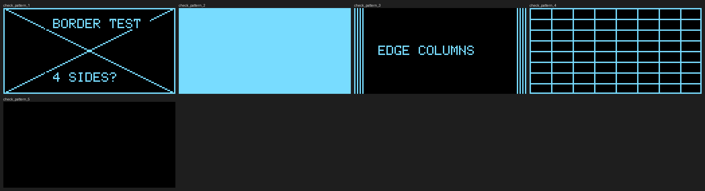
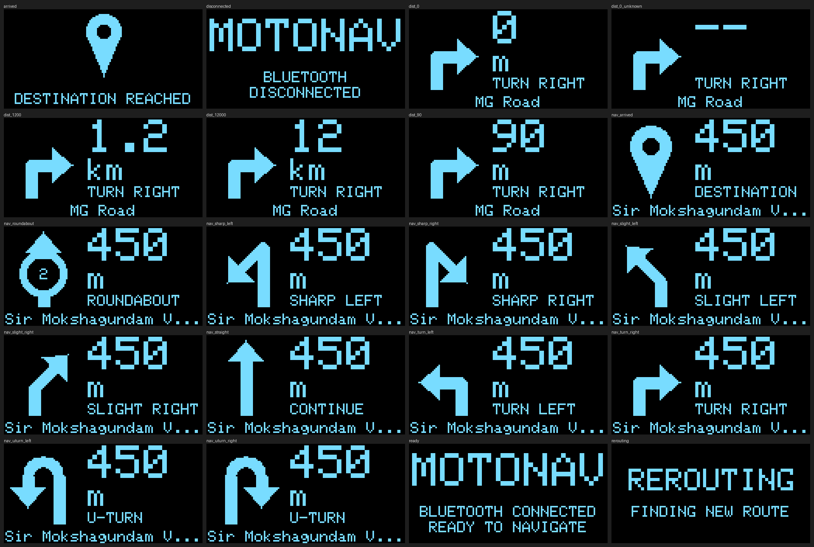
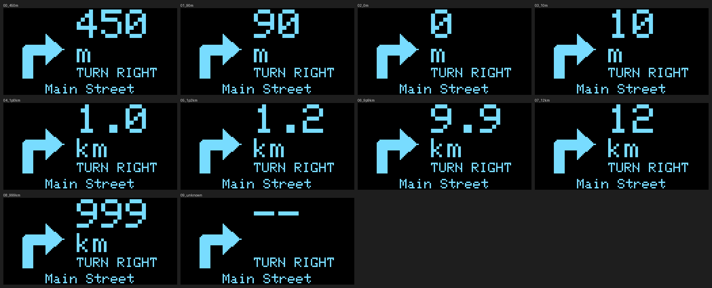
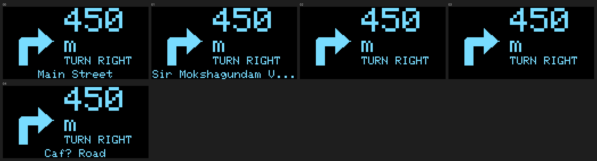

# Testing

Every result in this document carries one of three labels, and they are never mixed:

- **Host-tested**: automated tests, simulations or rendered images on a normal computer
  (Linux, gcc 13.3 and clang 18.1). Says nothing about the physical hardware.
- **Compile-checked**: the device-side code was built by the real ESP32 toolchain. Says
  nothing about whether it runs.
- **Device-tested**: run on the real board and display, by the board owner.
  **Nothing is device-tested yet.** The AI assistant has no access to the hardware and
  has not marked any hardware test as passed. Every hardware result below says
  `NOT RUN` until the board owner fills it in with real evidence.

Last updated: preparation for the physical hardware validation (2026-11-08).

## 0. Status at a glance

| Area | Label | Status |
|---|---|---|
| Firmware logic: model, screens, simulation, diagnostics verdicts (53 C++ tests) | Host-tested | pass |
| Log analyser, `hw_check` and `oled_check` simulations, documentation checks (56 Python tests) | Host-tested | pass |
| Firmware and both diagnostics build with the real ESP32 toolchain | Compile-checked | pass, 0 warnings |
| **T1** ESP32 identification | Device-tested | **NOT RUN** |
| **T2** I2C detection | Device-tested | **NOT RUN** |
| **T3** OLED controller validation | Device-tested | **NOT RUN** |
| **T4** Main firmware validation | Device-tested | **NOT RUN** |
| **T5** 30-minute continuous operation | Device-tested | **NOT RUN** |
| **T6** 12-hour soak (extended reliability test) | Device-tested | **NOT RUN** |

## 1. Host tests

Run from `firmware/host`. They need a C++ compiler and `make`; the Python ones also need
Python 3.

```bash
make test                            # layering check + 53 C++ tests (gcc, ASan + UBSan, -Werror)
make test-tools                      # builds the simulators, then 56 Python tests
make -B test CXX=clang++ SANITIZE=   # second compiler, no sanitizers
make render                          # screen images in out/ (needs Pillow for the contact sheets)
make reference                       # regenerates docs/reference/ (images and expected outputs)
make golden-update                   # accept a deliberate rendering change (look at the images first!)
```

### Results (Host-tested)

| Run | Result |
|---|---|
| gcc 13.3, `-std=c++11 -Wall -Wextra -Wpedantic -Werror`, AddressSanitizer + UBSan: `make test` | **53 tests, 39,148 checks, 0 failed** |
| clang 18.1, same warnings, no sanitizers: `make test` | **53 tests, 39,148 checks, 0 failed**; golden hashes identical to gcc |
| gcc with sanitizers: `make test-tools` | **56 Python tests, OK** |
| Layering check (`check_layering.sh`) | ok |

clang could not be run with sanitizers: this sandbox's clang has no AddressSanitizer
runtime library. gcc covered the sanitizers. (AddressSanitizer did catch one real bug
while these tests were written: a use-after-scope in a *test*, fixed.)

### What the tests cover

| Area | Tests |
|---|---|
| Distance formatting | 33 boundary cases; over 0-30,000 m the shown value never goes backwards and never differs from the truth by more than half a display step |
| Text and view building | width arithmetic, fitting with `...`; screen selection; road-name cleanup (UTF-8, Malayalam, cut mid-character); equal-looking states give equal views |
| Rendering | every screen at 128x64 and 128x32 stays inside the canvas and is neither blank nor solid; all 11 icons pairwise different; left/right icons mirror each other; every turn icon leans towards its side; roundabout shows its exit number; golden hashes of 34 screens |
| Flicker policy | over two full simulation loops (1,720 ticks) exactly 604 frames are presented, equal to the independently counted number of visible changes |
| Simulation | all 5 screens and 11 maneuvers visited; the `d` and `r` serial commands show exactly the distances and road names the documentation lists |
| **Diagnostic verdicts** | every pass/warn/fail rule of `hw_check`: chip, BLE required, cores, flash size (a 2 MB chip that claims 4 MB fails), pin validity (flash pins, input-only pins, strapping pins), I2C line states, probe reliability (one missed probe fails), OLED address (an unrelated device is never taken for the OLED, 0x3D is reported with the line to paste, swapped wires named) |
| **Frame consistency and log lines** | FNV-1a hash against published test vectors; a screen that changes is detected; the exact text of every log line the analyser reads |
| **`hw_check` simulation** | the real `hw_check.cpp` run against 16 simulated boards: healthy; OLED at 0x3D; both addresses; unrelated device; nothing connected; swapped wires; SDA shorted; no pull-ups; intermittent contact; device that only answers at 100 kHz; wrong chip; no BLE; 2 MB flash; 8 MB flash; unreadable flash; single core; and a mid-run unplug |
| **`oled_check` simulation** | the real `oled_check.cpp` draws exactly what this document says each of the five patterns looks like on a healthy SSD1306 |
| **Log analyser** | a clean 30-minute and 12-hour log pass; each of a leak, slow leak, fragmentation, reboot, brown-out, crash, firmware stall, frozen display, slow display updates, render mismatch, low stack, display init failure, too-short run, missing banner is detected; heap jitter is not mistaken for a leak |
| **Documentation** | this document cannot silently go stale: a test fails if any expected-output line shown here no longer matches what the code prints, or if any hardware test is recorded as passed |
| Architecture | `check_layering.sh` fails if `core/`, `sim/`, `ui/` or `diag/` include Arduino, Wire, a display driver or a radio header |

### Do the tests actually catch bugs? (Host-tested)

Bugs were injected one at a time, each was detected by the expected test, and the code was
restored (and verified identical) afterwards:

| Injected bug | Caught by (observed failing) |
|---|---|
| Distance rounded to 100 m instead of 50 m steps | `distance_boundaries` |
| Presenter always redraws (flicker) | `presenter_draws_first_frame_then_only_on_visible_change` |
| `#include <Arduino.h>` added to `core/` | layering check |
| `TurnLeft` drawn as a right turn | `all_maneuver_icons_are_distinct`, `left_and_right_icons_mirror_each_other` |
| One missed probe counted as a pass | `test_intermittent_contact_fails` |
| `hw_check` never tries the swapped-wires scan | `test_swapped_wires_fail_and_say_so`, `test_nothing_connected_fails` |
| A flash chip smaller than 4 MB accepted | `test_small_flash_fails_even_if_the_image_header_claims_4mb` |
| Analyser ignores a falling heap | `test_memory_leak_fails`, `test_fragmentation_fails`, `test_exit_codes` |

Only the first few failure lines of each run were inspected.

### Visual review of the screens (Host-tested; judgement of the AI assistant)

The rendered contact sheets were inspected. Findings and fixes: sharp-turn arrows were an
unrecognisable blob on the first render (fixed); turn arrows sat off-centre (fixed); on
128x32 the distance was small and "ARRIVED" overlapped the pin (both fixed). Stray single
pixels on some arrowheads remain: they come from the host's triangle rasteriser, and the
real display uses Adafruit GFX's, so edge pixels can differ by about a pixel.
**How the screens look on the real panel is not known yet.**

## 2. Compile check of the device code

**Compile-checked. Not run.** Built with PlatformIO for the board `esp32doit-devkit-v1`
(a classic ESP32, 4 MB flash). The hardware itself is still **provisional** (see
[HARDWARE.md](HARDWARE.md)).

| Environment | What it is | Result | Static RAM | Flash (app partition) | Warnings |
|---|---|---|---|---|---|
| `motonav` | the MotoNav firmware | **SUCCESS** | 23,860 B (7.3 %) | 377,280 B of 1,310,720 B (28.8 %) | 0 |
| `hw_check` | diagnostic: chip, board and I2C checks | **SUCCESS** | 23,924 B (7.3 %) | 341,908 B of 1,310,720 B (26.1 %) | 0 |
| `oled_check` | diagnostic: five OLED test patterns | **SUCCESS** | 23,684 B (7.2 %) | 356,432 B of 1,310,720 B (27.2 %) | 0 |

Built with `-Wall -Wextra`. Versions (pinned in `firmware/platformio.ini`): PlatformIO
Core 6.2.0, platform `espressif32@8.0.0`, framework package
`framework-arduinoespressif32@4.30312.261024`, toolchain packages
`toolchain-xtensa-esp-elf` and `toolchain-riscv32-esp` 14.2.0+20260121, Adafruit GFX
Library 1.13.0, Adafruit SSD1306 2.5.17, Adafruit BusIO 1.17.4, esptool 5.4.0. Most of the
flash is the Arduino core itself. RAM is static usage only.

Compiling proved that the device APIs the diagnostics use exist in this framework version
(`esp_flash_read_id`, `esp_reset_reason`, `uxTaskGetStackHighWaterMark`,
`ESP.getMaxAllocHeap`, `INPUT_PULLDOWN`, `Wire.begin` returning a status). **It did not show
that they behave as expected on the chip.** In particular, reading the flash chip's own
JEDEC id (T1) is untested on real hardware.

Build-system checks, each performed: each environment compiles only its own sources;
building the firmware for an ESP32-S3 is refused by the `#error` in `src/main.cpp`;
building with any of the five `MOTONAV_*` display values missing is refused; the Arduino
variant for this board defines `SDA = 21`, `SCL = 22`; `esptool chip-id` and `flash-id`
exist in the pinned esptool (`--help` only; not run against a board).

## 3. Physical hardware validation (to be run by the board owner)

### 3.1 Ground rules

1. Run the tests **in order**: T1, T2, T3, T4, T5, then T6. **Stop at the first FAIL**,
   record it, and report it. Fixing a wire and re-running the same test is fine; skipping
   ahead is not.
2. A test **passes only if every pass criterion was met by what you actually observed.**
   If you are unsure, it is not a pass. Write what you saw.
3. Keep evidence: save each serial log to a file and take the photos listed in each test.
4. **The expected outputs below come from simulations.** They were produced by running the
   real diagnostic code against a *simulated* board, or the firmware logic on a computer.
   Values such as the MAC address, chip revision, flash chip id and heap sizes are
   **invented** and will differ on your board. Compare the *shape* of the output and the
   `PASS` / `WARN` / `FAIL` words, not the numbers.
5. Nothing in this document tells you the hardware is good. Only your results do.

### 3.2 Before you start

You need: the ESP32 board, the OLED, four jumper wires, a USB cable that carries data (a
charge-only cable gives no serial port), a computer with PlatformIO, a phone for photos and
a short video, and a computer USB port that stays powered (avoid unpowered hubs). For T5 and
T6 you also need Python 3 (`python --version`).

```bash
git clone https://github.com/sreekanthmp/MotoNav.git
cd MotoNav
git checkout claude/magical-hamilton-nv0umh
```

Wire the display by its own pin labels as described in [HARDWARE.md](HARDWARE.md) section 3
(**OLED pin order differs between modules; reversed power can destroy the display**), then
connect USB. Do **not** change the wiring while USB is connected, except where a test says so.

Optional sanity check that this checkout works on your computer (needs `g++`, `make`,
Python 3; skip on Windows): `cd firmware/host && make test test-tools`.

**Where to run commands.** Run every `pio` command **from the `firmware/` folder**, and keep your
log files there. That folder holds `platformio.ini`, which sets the serial speed to 115200 baud:
from anywhere else the monitor falls back to 9600 baud and shows garbage. The command blocks below
start with `cd firmware` for a fresh terminal; if you are already in `firmware/`, that line just
prints an error and you can ignore it. Paths in the commands below (such as `host/analyze_log.py`)
are relative to `firmware/`.

To save a serial log while watching it:

```bash
# Linux / macOS
pio device monitor | tee t1.log
# Windows PowerShell
pio device monitor | Tee-Object -FilePath t1.log
```

(PlatformIO's own `pio device monitor --filter log2file` also works and writes into a `logs/`
folder.) Press the board's **EN** button after starting the monitor so the log begins with
the boot messages. Stop the monitor with Ctrl+C.

---

### T1. ESP32 identification

**Purpose:** establish what the board really is: chip, radios, flash size, board
compatibility, whether the configured I2C pins are usable, and the electrical state of SDA
and SCL.

**Label when done:** Device-tested.

```bash
cd firmware
pio run -e hw_check -t upload
pio device monitor | tee t1.log          # then press EN
```

If upload stalls at `Connecting......`, hold the board's **BOOT** button until it starts.

**Expected output** (a healthy board; produced by running the real `hw_check.cpp` against a
**simulated** board, so the numbers are invented):

```text
MotoNav hw_check (diagnostic, not the MotoNav firmware)
config: 128x64 display, expected address 0x3C, SDA=GPIO21 SCL=GPIO22

========== hw_check run 1 ==========
--- Chip and board ---
Silicon model    : ESP32 (classic)
Model (SDK name) : ESP32-D0WD-V3
Revision         : 301
CPU              : 2 core(s) at 240 MHz
Radios           : Wi-Fi BLE Bluetooth-Classic
MAC (eFuse)      : 240AC4123456
Flash JEDEC id   : 0xEF4016 (manufacturer 0xEF, capacity code 0x16)
Flash from chip  : 4194304 bytes
Flash per SDK    : 4194304 bytes
[PASS] chip: classic ESP32, as expected
[PASS] radios: Wi-Fi and BLE present
[PASS] cpu: dual core at 240 MHz, as expected
[PASS] flash: 4 MB, as expected (read from the flash chip itself)
--- I2C pins and electrical state ---
Configured: SDA=GPIO21 SCL=GPIO22
[PASS] SDA pin: usable for I2C
[PASS] SCL pin: usable for I2C
[PASS] pin pair: SDA and SCL are different pins
SDA line (GPIO21): with internal pull-up reads HIGH, with internal pull-down reads HIGH
[PASS] SDA line: a strong external pull-up resistor is present (good)
SCL line (GPIO22): with internal pull-up reads HIGH, with internal pull-down reads HIGH
[PASS] SCL line: a strong external pull-up resistor is present (good)
--- I2C bus ---
100 kHz: device at 0x3C
400 kHz: device at 0x3C
Scan results at 100 kHz: ack=1 nack-on-address=125 nack-on-data=0 other=0 timeout=0
(Informational. Empty addresses normally all report the same code. A mixture of codes can mean noise.)
[PASS] OLED address: OLED found at the configured address
OLED detected at 0x3C
Probes at 100 kHz: 200 of 200 acknowledged
Probes at 400 kHz: 200 of 200 acknowledged
[PASS] probes at 100 kHz: every probe was acknowledged
[PASS] probes at 400 kHz: every probe was acknowledged
--- Summary ---
HW_CHECK RESULT: PASS  (12 pass, 0 warn, 0 fail)
run 2: PASS, OLED found, same as the previous run (1 in a row)
run 3: PASS, OLED found, same as the previous run (2 in a row)
```

The first full report appears within a few seconds of boot. Afterwards it prints one short
line every 5 seconds, and prints a full report again only if something changes.

**Pass criteria:**

| # | Criterion | Look for | Pass when |
|---|---|---|---|
| 1.1 | Upload and serial work | PlatformIO says `SUCCESS`; text appears at 115200 baud | yes |
| 1.2 | The chip is a classic ESP32 | `[PASS] chip`, `Silicon model: ESP32 (classic)` | PASS |
| 1.3 | BLE is present (Phase 2 needs it) | `[PASS] radios`, `BLE` in the Radios line | PASS |
| 1.4 | Dual core at 240 MHz | `[PASS] cpu` | PASS, or a WARN you report |
| 1.5 | Flash is 4 MB, **read from the flash chip itself** | `[PASS] flash`, `Flash from chip: 4194304 bytes`, a JEDEC id line | PASS |
| 1.6 | Board compatibility with the `esp32doit-devkit-v1` definition (classic ESP32, 4 MB, 240 MHz) | criteria 1.2 to 1.5 | all met |
| 1.7 | The configured SDA and SCL pins are usable GPIOs | `[PASS] SDA pin`, `[PASS] SCL pin`, `[PASS] pin pair` | PASS |
| 1.8 | The I2C lines are electrically sane | `[PASS] SDA line`, `[PASS] SCL line` | PASS. A `WARN ... no strong external pull-up` is accepted only if T2 then passes completely, and must be reported |

**If it fails:**

| What you see | Meaning | What to do |
|---|---|---|
| `[FAIL] chip ... NOT a classic ESP32` | the board is another ESP32 family | **Stop and report.** The firmware is deliberately not built for it |
| `[FAIL] radios ... no BLE` | no BLE on this chip | **Stop and report** |
| `[FAIL] flash ... smaller than the 4 MB` | the flash is smaller than the firmware's layout needs | **Stop and report** |
| `[WARN] flash ... differs` or `could not be read` | size source disagreement | run `pio pkg exec -p tool-esptool -- esptool flash-id` and send its output |
| `[WARN] cpu` | single core or slower clock | report; Phase 1 does not need the second core |
| `[FAIL] SDA pin` or `SCL pin` | the pin in `platformio.ini` cannot be used for I2C | report; do not rewire without asking |
| `[FAIL] SDA line ... shorted to GND` | a line is held low | unplug USB, check the wiring for shorts, retry |
| `[FAIL] ... inconsistent readings` | something is driving the line | unplug USB, check the wiring |
| no serial text at all | wrong port, charge-only cable, driver missing, or wrong baud | HARDWARE.md section 4 (V2) |
| garbled text | wrong baud rate | the monitor must be 115200 |

**Evidence to send:** the complete `t1.log`, and a photo of the ESP32 module's marking.

**Result record:**

| Date | Tester | Result | Notes |
|---|---|---|---|
| | | **NOT RUN** | |

---

### T2. I2C detection

**Purpose:** establish that the OLED answers on the bus, at which address (**never assume
0x3C**), that SDA and SCL are wired the right way round, and that the bus is reliable.

**Label when done:** Device-tested.

This uses the same `hw_check` firmware as T1. If it is still running, continue; otherwise
re-upload it.

1. Read the **I2C bus** part of the output. Find the line `OLED detected at 0x..`. That
   address came from detection on the bus, not from the configuration.
2. If an `ACTION:` line appears, edit `firmware/platformio.ini` exactly as it says, upload
   `hw_check` again, and confirm `[PASS] OLED address`.
3. Leave it running for **at least 2 minutes** without touching anything. You should see
   `same as the previous run (N in a row)` counting up to 20 or more.
4. While it runs, **gently** press and wiggle each of the four connectors, one at a time.
   Each unstable connection should produce `something changed since the previous run` and a
   full report. Record which wire does that.

**Expected output** (from the T1 listing above, I2C part): both scans list the same
address, `OLED detected at 0x3C`, then `Probes at 100 kHz: 200 of 200 acknowledged` and
`Probes at 400 kHz: 200 of 200 acknowledged`, then `[PASS]` for each.

**Pass criteria:**

| # | Criterion | Look for | Pass when |
|---|---|---|---|
| 2.1 | The OLED responds | a `device at 0x..` line at 100 kHz and at 400 kHz | yes, same address at both speeds |
| 2.2 | The address was detected, not assumed | `OLED detected at 0x..`; `[PASS] OLED address` once `platformio.ini` matches | PASS |
| 2.3 | SDA and SCL are the right way round | no `swapped` message | none |
| 2.4 | **No bus errors**: the OLED acknowledges every probe, at the speed the firmware uses | `[PASS] probes at 100 kHz` **and** `[PASS] probes at 400 kHz` (200 of 200 each) | both PASS |
| 2.5 | The bus is stable | at least 20 `same as the previous run` lines in a row, no `something changed` | yes (when you are not touching wires) |

The line `Scan results at 100 kHz: ack=.. nack-on-address=.. other=.. timeout=..` is
informational. Record it. If `other` or `timeout` are not zero for *empty* addresses, report
it: it may only be how this Arduino version reports an empty address, so it is not a pass
criterion by itself. The pass criterion is that the OLED itself never fails to answer.

**If it fails:**

| What you see | Meaning | What to do |
|---|---|---|
| `[WARN] OLED address ... NOT at the address in platformio.ini` | the OLED is at the other address | do what the `ACTION:` line says, re-upload, re-run |
| `[FAIL] ... only with SDA and SCL swapped` | the two signal wires are swapped | unplug USB, swap them |
| `[FAIL] ... no I2C device answered` (and the swapped scan found nothing) | no power, wrong pins, bad contact, or not a 4-pin I2C OLED | check VCC, GND, SDA, SCL against HARDWARE.md section 3; check the `SDA line` / `SCL line` results |
| `[WARN] ... devices at BOTH 0x3C and 0x3D` | another device is on the bus | report |
| `[WARN] ... none at a typical OLED address` | the device is something else, or an unusual OLED | report the addresses |
| `[FAIL] probes ... intermittent` | a connection is loose or the leads are poor | reseat the jumpers, try shorter leads, re-run; report if it persists |
| `[FAIL] probes at 400 kHz` but `[PASS] probes at 100 kHz` | the bus works slowly but not at the speed the firmware needs | report; do not proceed |
| `something changed` while you were not touching anything | an unstable connection | reseat the jumpers; report |

**Evidence to send:** the `hw_check` log covering the 2-minute run, and which (if any) wire
caused changes.

**Result record:**

| Date | Tester | OLED address found | Result | Notes |
|---|---|---|---|---|
| | | | **NOT RUN** | |

---

### T3. OLED controller validation

**Purpose:** confirm the display initialises, renders the full 128x64 area correctly, and
works with the SSD1306 driver the firmware uses. If it looks like an SH1106, **stop**:
the display driver must be investigated before any production code changes.

**Label when done:** Device-tested.

```bash
cd firmware
pio run -e oled_check -t upload
pio device monitor | tee t3.log
```

The display cycles through five test patterns, six seconds each. Type `1` to `5` in the
serial monitor to hold one pattern, and `a` to cycle again. Photograph each pattern close
to the glass. (Phone cameras can show dark bands on an OLED: that is the camera's shutter,
not necessarily a fault. If a photo looks banded, take several, or a short video.)

**Expected serial output** (produced by running the real `oled_check.cpp` against a
simulated panel):

```text
MotoNav oled_check (diagnostic, not the MotoNav firmware)
config: 128x64 at 0x3C, SDA=21 SCL=22
Driving the panel as an SSD1306. Keys: 1 to 5 hold a pattern, a = cycle.
pattern 1 of 5: border (expect all four sides)
pattern 2 of 5: all pixels on (expect solid white to every edge)
pattern 3 of 5: edge columns (expect 4 lines at each side, 2 px apart)
pattern 4 of 5: grid (expect 8 rows x 8 columns of regular cells)
pattern 5 of 5: all pixels off (expect completely dark)
```

**What a healthy SSD1306 should show** (predicted by running the real drawing code on a
bitmap; this is **not** a photograph, and pixel edges can differ slightly on the real
glass). The image below is `docs/reference/oled_check_patterns.png`:



**Pass criteria** (all must be met):

| # | Criterion | Pattern | Pass when |
|---|---|---|---|
| 3.1 | Initialisation works | serial | `Driving the panel as an SSD1306...`; **no** `NO ANSWER` |
| 3.2 | No missing edges | 1 (border) | a complete rectangle on the very edge of the glass: **all four sides**, diagonals reaching all four corners |
| 3.3 | Solid to every edge | 2 (all on) | solid white to **all four edges**, no dark or speckled strip |
| 3.4 | No lost columns | 3 (edge columns) | **four** thin lines at the left edge and **four** at the right edge, evenly spaced |
| 3.5 | Correct 128x64 geometry, nothing scrambled | 4 (grid) | a regular grid of **8 rows by 8 columns**, with no broken, shifted, repeated or uneven cells |
| 3.6 | No stuck pixels or noise | 5 (all off) | **completely dark**; no lit pixel, speckle or stripe anywhere |

A two-colour module (a yellow band across the top 16 rows, blue below) is normal and does
not affect the criteria.

**Deciding SSD1306 versus SH1106.** An SSD1306 has 128 columns of display memory; an SH1106
has 132 and shows columns 2 to 129, and uses a different memory-addressing scheme. Driven by
the SSD1306 driver, an SH1106 is *expected* to lose the first two columns on the left, show
speckles on the right edge, and possibly look scrambled or torn. (This is predicted from the
controllers' designs and has not been seen on your panel.) So:

- **All five patterns match: the controller is compatible with the SSD1306 driver.**
- **Anything else: stop.** Send the photos. Do not guess whether it is the controller, the
  wiring or the power.

**If it fails:**

| What you see | Likely cause | What to do |
|---|---|---|
| `NO ANSWER at 0x..` | wrong address, wiring | back to T2 |
| Nothing lights, no error | display unpowered or contrast off | check VCC and GND; report |
| Left border or left lines missing, speckles on the right | SH1106 (expected symptom) | **stop and report with photos** |
| Only the top half shows, or the picture repeats or is squashed | a 128x32 panel configured as 128x64 | report; one-line change |
| Scrambled, torn or noisy picture | SH1106, or a wiring/power fault | **stop and report with photos** |
| Upside down or mirrored | panel mounted the other way up | report; easy to change |
| Lit pixels in pattern 5 | stuck pixels or controller mismatch | report with a photo |

**Evidence to send:** `t3.log`, and one photo of **each of the five patterns**.

**Result record:**

| Date | Tester | Controller conclusion | Result | Notes |
|---|---|---|---|---|
| | | | **NOT RUN** | |

---

### T4. Main firmware validation

**Purpose:** verify that the MotoNav firmware boots reliably, draws all five screens and all
11 maneuver icons correctly, formats distances and road names correctly, switches screens
cleanly, and does not flicker or reset.

**Label when done:** Device-tested. **Only run after T1 to T3 passed.**

```bash
cd firmware
pio run -e motonav -t upload
pio device monitor | tee t4.log
```

The firmware prints, on every serial command that holds a screen, an `expect:` line saying
exactly what the display should be showing. **Compare the display with that line and with
the reference sheets** (`docs/reference/`, generated by the same code, so they match the
`expect:` lines). The reference images are predictions from the drawing code, not photographs.



#### T4.1 Boot reliability and the boot output

Expected at every boot (the chip line shows your board's values, and the `[render]` lines
appear as each static screen is drawn for the first time; their hashes are specific to your
board's build):

```text
MotoNav firmware - Phase 1 (simulated navigation, no BLE)
reset: POWERON
chip: <your chip model> rev <n>, 2 core(s), flash 4194304 bytes
config: 128x64 display at 0x3C, SDA=21 SCL=22
I2C scan:
  device at 0x3C
display: initialised
[render] baseline screen=Disconnected hash=<8 hex digits>
```

- Unplug and replug USB **20 times**. After each, note whether the display shows the
  **MOTONAV / BLUETOOTH DISCONNECTED** screen within about two seconds, and that the serial
  log shows `display: initialised`.
- Press the **EN** button **20 times** and do the same. (`reset:` should say `POWERON` or
  `EXT` for these; either is normal.)

| Criterion | Pass when |
|---|---|
| 4.1a | on all 20 power-ups the display shows the first screen, never blank, never garbled |
| 4.1b | on all 20 resets, the same |
| 4.1c | every boot's serial output contains `display: initialised` and a `reset:` line of `POWERON` or `EXT` |
| 4.1d | the `config:` line reads 128x64 at the address from T2 |

| Power-ups OK of 20 | Resets OK of 20 | Faults seen | Result |
|---|---|---|---|
| | | | **NOT RUN** |

#### T4.2 A failed initialisation recovers

1. With the board running, disconnect the **SDA signal wire only** (never VCC or GND) from
   the board, then press EN.
2. Expect, repeating about every 2 seconds: `display: no answer at 0x.. (I2C error N)`
   (`N` is an error code). It must **not** reboot repeatedly.
3. Reconnect the SDA wire. Within about 2 seconds expect `display: initialised` and the
   first screen.

| Criterion | Pass when |
|---|---|
| 4.2a | the no-answer message repeats and the boot banner does **not** repeat (no reboot loop) |
| 4.2b | after reconnecting, the display recovers by itself, without a reset |

| Result | Notes |
|---|---|
| **NOT RUN** | |

#### T4.3 The five screens

Type the key in the serial monitor; the screen holds until you type another.

| Press | Serial prints | The display should show |
|---|---|---|
| `0` | `expect: screen=Disconnected` | Large **MOTONAV**, and below it **BLUETOOTH** / **DISCONNECTED** |
| `1` | `expect: screen=Ready` | Large **MOTONAV**, and below it **BLUETOOTH CONNECTED** / **READY TO NAVIGATE** |
| `2` | `expect: screen=Navigating icon=Straight distance="450 m" road="Main Street"` | A straight-up arrow on the left; **450** large with **m** below it, **CONTINUE**, and **Main Street** along the bottom |
| `3` | `expect: screen=Rerouting` | **REROUTING** in large letters, and **FINDING NEW ROUTE** below |
| `4` | `expect: screen=Arrived` | A map-pin icon, and **DESTINATION REACHED** along the bottom |

| Criterion | Pass when |
|---|---|
| 4.3 | all five screens match the description and the reference sheet; text complete, nothing cut off, nothing shifted |

| Result | Notes |
|---|---|
| **NOT RUN** | |

#### T4.4 The 11 maneuver icons (arrow clarity)

Press `2`, then `n` eleven times. Each press moves to the next maneuver; the eleventh wraps
back to the first. For each, compare the display with the table and the reference sheet.

| Press | Serial prints | Instruction text | The arrow should look like |
|---|---|---|---|
| `2` | `expect: screen=Navigating icon=Straight distance="450 m" road="Main Street"` | CONTINUE | an arrow pointing straight up |
| `n` | `expect: screen=Navigating icon=TurnLeft distance="450 m" road="Main Street"` | TURN LEFT | an L-shaped arrow: up, then bending left, arrowhead pointing left |
| `n` | `expect: screen=Navigating icon=TurnRight distance="450 m" road="Main Street"` | TURN RIGHT | the mirror image: bending right, arrowhead pointing right |
| `n` | `expect: screen=Navigating icon=SlightLeft distance="450 m" road="Main Street"` | SLIGHT LEFT | an arrow leaning up and to the left at about 45 degrees |
| `n` | `expect: screen=Navigating icon=SlightRight distance="450 m" road="Main Street"` | SLIGHT RIGHT | an arrow leaning up and to the right at about 45 degrees |
| `n` | `expect: screen=Navigating icon=SharpLeft distance="450 m" road="Main Street"` | SHARP LEFT | an arrow going up, then folding back down to the left (arrowhead pointing down-left) |
| `n` | `expect: screen=Navigating icon=SharpRight distance="450 m" road="Main Street"` | SHARP RIGHT | the mirror image (arrowhead pointing down-right) |
| `n` | `expect: screen=Navigating icon=UTurnLeft distance="450 m" road="Main Street"` | U-TURN | a U-shaped arrow: up on the right, over the top, arrowhead pointing down on the left |
| `n` | `expect: screen=Navigating icon=UTurnRight distance="450 m" road="Main Street"` | U-TURN | the mirror image: up on the left, over the top, arrowhead pointing down on the right |
| `n` | `expect: screen=Navigating icon=Roundabout exit=2 distance="450 m" road="Main Street"` | ROUNDABOUT | a ring with the digit **2** inside, a stem entering from below, and an arrowhead leaving at the top |
| `n` | `expect: screen=Navigating icon=Arrived distance="450 m" road="Main Street"` | DESTINATION | a map pin: a circle with a hole above a point |
| `n` | `expect: screen=Navigating icon=Straight distance="450 m" road="Main Street"` | CONTINUE | an arrow pointing straight up (wraps back to the start) |

Judge each icon **at arm's length, at a glance**: could a rider tell the arrow types apart?

| Criterion | Pass when |
|---|---|
| 4.4a | all 11 icons are recognisable and match the table |
| 4.4b | left and right variants point the right way (not mirrored) |
| 4.4c | the roundabout shows a legible **2** inside the ring |

| Maneuver | Recognisable? (yes/no) | Notes |
|---|---|---|
| (record all 11) | | |

Photograph all 11 (or send a short video of the sequence). Result: **NOT RUN**.

#### T4.5 Distance formatting

Press `d` ten times (the maneuver stays as last chosen). The large number and its unit must
match the table; the tenth press wraps back to 450 m. The reference sheet is
`docs/reference/t4_distances.png`.

| Press | Serial prints | Large number and unit on the display |
|---|---|---|
| `d` | `expect: screen=Navigating icon=Straight distance="90 m" road="Main Street"` | **90 m** |
| `d` | `expect: screen=Navigating icon=Straight distance="0 m" road="Main Street"` | **0 m** |
| `d` | `expect: screen=Navigating icon=Straight distance="10 m" road="Main Street"` | **10 m** |
| `d` | `expect: screen=Navigating icon=Straight distance="1.0 km" road="Main Street"` | **1.0 km** |
| `d` | `expect: screen=Navigating icon=Straight distance="1.2 km" road="Main Street"` | **1.2 km** |
| `d` | `expect: screen=Navigating icon=Straight distance="9.9 km" road="Main Street"` | **9.9 km** |
| `d` | `expect: screen=Navigating icon=Straight distance="12 km" road="Main Street"` | **12 km** |
| `d` | `expect: screen=Navigating icon=Straight distance="999 km" road="Main Street"` | **999 km** |
| `d` | `expect: screen=Navigating icon=Straight distance="--" road="Main Street"` | **--** |
| `d` | `expect: screen=Navigating icon=Straight distance="450 m" road="Main Street"` | **450 m** |



| Criterion | Pass when |
|---|---|
| 4.5a | all ten distances show exactly as listed |
| 4.5b | the number is the largest text on the screen and easy to read |

Result: **NOT RUN**. Notes:

#### T4.6 Road name positioning

Press `r` five times. The bottom line must match the table. The reference sheet is
`docs/reference/t4_road_names.png`.

| Press | Serial prints | Bottom line of the display |
|---|---|---|
| `r` | `expect: screen=Navigating icon=Straight distance="450 m" road="Sir Mokshagundam Visvesvaraya R"` | Sir Mokshagundam V... (shortened to fit 21 characters, ending in three dots) |
| `r` | `expect: screen=Navigating icon=Straight distance="450 m" road=""` | no road line at all |
| `r` | `expect: screen=Navigating icon=Straight distance="450 m" road=""` | no road line at all (the Malayalam name has no letters the font can draw, so it is hidden) |
| `r` | `expect: screen=Navigating icon=Straight distance="450 m" road="Caf? Road"` | Caf? Road (the accented letter becomes a question mark) |
| `r` | `expect: screen=Navigating icon=Straight distance="450 m" road="Main Street"` | Main Street |

Note that the serial line shows the 31-character cleaned name, while the display fits it to
21 characters.



| Criterion | Pass when |
|---|---|
| 4.6a | each road line is as listed, centred along the bottom, within the glass |
| 4.6b | where the table says "no road line", nothing is drawn there |

Result: **NOT RUN**. Notes:

#### T4.7 Screen transitions and flicker

Type `a` (automatic mode) and watch for **5 minutes**, ideally recording a 60-second video.
The script repeats every 86 seconds:

| Time in loop | Screen |
|---|---|
| 0 to 4 s | Disconnected |
| 4 to 8 s | Ready |
| 8 to 74 s | the 11 maneuvers, 6 s each, in the order of T4.4, each counting down from 1.5 km to about 45 m, with these roads in turn: Main Street, MG Road, Outer Ring Road, National Highway 66, Sir Mokshagundam V..., (none), Pacific Coast Highway, Main Street, MG Road, Outer Ring Road, National Highway 66 |
| 74 to 78 s | Rerouting |
| 78 to 83 s | Arrived |
| 83 to 86 s | Ready (navigation stopped), then it repeats |

| Criterion | Pass when |
|---|---|
| 4.7a | every transition is clean: no blank flash, half-drawn screen, tearing or garbage |
| 4.7b | no visible flicker or flashing; the screen changes only when the text or icon changes |
| 4.7c | no jitter or shifting of text between updates |
| 4.7d | **no unexpected reset**: the boot banner appears only at the start of `t4.log`, never again |

(A phone camera may show bands; judge with your eyes, and report what the camera shows
separately.)

| Result | Notes |
|---|---|
| **NOT RUN** | |

**Evidence to send for T4:** `t4.log`; photos of the five screens; photos or a video of the
11 icons; photos of the distance and road-name checks that did *not* match; the 5-minute
transition video if anything looked wrong.

**If T4 fails:**

| What you see | Meaning | What to do |
|---|---|---|
| Display shows nothing but serial says `initialised` | wiring or contrast, or SH1106 | back to T3 |
| A screen does not match its `expect:` line | a rendering or wiring fault | send a photo and the log |
| An icon looks wrong or mirrored | rendering differs from the host prediction | send a photo of that icon; do not change code |
| Any distance differs from the table | formatting fault | send the serial line and a photo |
| Flashing or tearing during automatic mode | frame updates not clean | send a video |
| `reset: BROWNOUT`, `PANIC`, `TASK_WDT` or `INT_WDT`, or the banner appears again | the board restarted | send the whole log; try another USB cable or port |

---

### T5. 30-minute continuous operation

**Purpose:** run the navigation simulation continuously and watch free heap, unexpected
resets, display freezing, memory stability and rendering consistency, judged by a program
instead of by eye.

**Label when done:** Device-tested. **Only run after T4 passed.**

1. Upload the firmware if needed: `cd firmware && pio run -e motonav -t upload`.
2. Start the monitor with a log, **then press EN** so the log starts with the boot lines:

   ```bash
   pio device monitor | tee t5.log          # Windows: | Tee-Object -FilePath t5.log
   ```

3. Take a photo of the running display. Leave it in automatic mode for **at least
   32 minutes** (the check needs 30 minutes of statistics). Look at the display now and then.
   Use a stable USB port and keep the computer awake: if the computer sleeps, the log stops
   and the board may lose power.
4. Stop the monitor (Ctrl+C) and photograph the display. **Do not type any key during the
   run**: a held screen stops the display from updating, and the analyser would report that as
   a frozen display.
5. Judge the log:

   ```bash
   python host/analyze_log.py t5.log --min-minutes 30
   ```

   (Run from `firmware/`. Use `python3` on Linux or macOS if `python` is not found, and `py` or
   `python` on Windows.) It exits with status 0 unless a criterion failed.
6. Only now check the display itself after the long run: open the monitor again (`pio device
   monitor`; the board may restart when it opens, which is fine for this check), type `0`,
   `1`, `2`, `3`, `4`, and compare each screen with your T4.3 photos. They should be identical.

The firmware prints a line like `[stats] uptime=60s heap_free=... heap_min=... max_alloc=...
stack_free=... frames=... present_max_ms=... render_mismatch=...` once a minute. The analyser
reads them. What each field means:

| Field | Meaning |
|---|---|
| `heap_free`, `heap_min` | free memory now, and the lowest it has been since boot |
| `max_alloc` | the largest single block that could be allocated (falls if memory fragments) |
| `stack_free` | the least free stack the main task has had, in bytes |
| `frames` | how many frames have been sent to the display |
| `present_max_ms` | the slowest single display update in the last minute |
| `render_mismatch` | how many times a screen that must always look the same came out different |

**Expected analyser output for a clean run** (produced from a **synthetic** log built with the
firmware's real log formatters; the numbers are invented):

```text
[PASS] boot banner          exactly one boot in the log
[PASS] reset reason         first boot: POWERON
[PASS] duration             ran 31 min 0 s (needed 30 min)
[PASS] stats cadence        stats every 60 to 60 s
[PASS] display updating     6510 frames in total, never fewer than 100 per minute
[PASS] free heap            free heap: lowest in first third 230000 B, lowest in last third 230000 B (change +0 B; range 230000 to 230000)
[PASS] heap fragmentation   largest free block: lowest in first third 110000 B, lowest in last third 110000 B (change +0 B; range 110000 to 110000)
[PASS] heap low-water mark  lowest-ever free heap went from 229000 B to 229000 B
[PASS] stack                least free stack seen: 5200 B
[PASS] display update time  slowest single display update: 38 ms (a full-screen update is normally tens of ms)
[PASS] render consistency   static screens were identical every time they were drawn
[PASS] display init         no display errors in the log

OVERALL: PASS
```

**Pass criteria:**

| # | Criterion | Pass when |
|---|---|---|
| 5.1 | the analyser's `OVERALL` line | `PASS`, or `WARN` that you have read and reported. **Any FAIL fails T5** |
| 5.2 | no unexpected resets | `[PASS] boot banner` (exactly one boot) and `[PASS] reset reason` |
| 5.3 | free heap | `[PASS] free heap` and `[PASS] heap fragmentation`: no downward trend |
| 5.4 | display not frozen | `[PASS] display updating`, and you saw it changing when you looked |
| 5.5 | rendering consistent | `[PASS] render consistency`, and the end-of-run screens match the T4.3 photos |
| 5.6 | the run was long enough | `[PASS] duration` |

**What the analyser can and cannot see.** It judges what the firmware logs. The render
consistency check watches the firmware's frame buffer in RAM, so it detects memory
corruption or changed drawing code. It **cannot** see a glitch on the I2C wires that corrupts
what the *glass* shows. That is why you look at the display and compare the end-of-run
photos.

**If it fails:**

| Analyser line | Meaning | What to do |
|---|---|---|
| `boot banner ... N boots` | the board restarted during the run | send the log; look at the `reset:` lines |
| `reset reason ... BROWNOUT` | the supply voltage dipped | try another USB cable or port; use a powered port |
| `reset reason ... PANIC` / `TASK_WDT` / `INT_WDT` / `WDT` | a crash or hang | send the whole log |
| `stats cadence ... gap` | the firmware stalled, or the log lost data | send the log; note whether the display froze |
| `display updating ... too few` | the display stopped updating | note when; send the log |
| `free heap` / `heap fragmentation` / `heap low-water mark` | memory falling | send the log |
| `stack` | the task is running out of stack | send the log |
| `display update time` | a display update was slow, for example a stalled I2C transfer | send the log |
| `render consistency` | a static screen changed | send the log and photos |
| `display init` | the display did not start cleanly | send the log |
| `duration` | the run was too short | repeat for 32 minutes |
| `boot banner ... starts mid-run` (WARN) | you started the monitor after boot | repeat with EN pressed after starting the monitor |

**Evidence to send:** `t5.log`, the analyser's output, the start and end photos, and anything
you saw (freeze, flicker).

**Result record:**

| Date | Run length | Analyser OVERALL | Result | Notes |
|---|---|---|---|---|
| | | | **NOT RUN** | |

---

### T6. 12-hour soak (extended reliability test)

**Purpose:** the extended version of T5. A 30-minute run cannot reveal a slow memory leak or a
fault that appears once an hour.

**Label when done:** Device-tested. **Only run after T5 passed.**

Same procedure as T5, but leave it for **at least 12 hours 5 minutes**, on a computer that
will not sleep, with a good USB cable and a powered port. Then:

```bash
python host/analyze_log.py t6.log --min-minutes 720
```

Pass criteria are those of T5, over 12 hours, plus the display still working and matching the
T4.3 photos at the end. The 12-hour run is far more sensitive to small leaks, so a `WARN` on
`free heap` here must be reported even though it does not fail the run.

| Date | Run length | Analyser OVERALL | Result | Notes |
|---|---|---|---|---|
| | | | **NOT RUN** | |

---

## 4. Known limitations

- **No hardware result exists yet.** Every T1 to T6 result is `NOT RUN`.
- All expected outputs and reference images come from simulations and predictions. Real values
  (chip revision, flash id, MAC, heap sizes, timings, edge pixels) will differ.
- The flash size check reads the flash chip's JEDEC id through `esp_flash_read_id`. It compiles,
  but has not run on a real chip. `esptool flash-id` is the independent cross-check.
- The pull-up test infers a "strong external pull-up" from how the line reads with the ESP32's
  weaker internal pull-up and pull-down enabled. It is a hint with a reasoned basis, not a
  measurement. A multimeter or oscilloscope would be the real check.
- The analyser and the render check cannot see glitches on the I2C wires that corrupt what the
  glass shows. Only your eyes and the photos can.
- A display unplugged **while running** is not detected by the driver; T4.2 only covers a failed
  initialisation.
- Readability in sunlight, brightness and burn-in are not covered by any test here.
- Only the 128x64 layout is the target. The 128x32 layout is host-tested only.
- Non-ASCII road names (for example Indian scripts) cannot be shown by the 5x7 font. They are
  replaced by `?` or hidden (T4.6 shows both).
- BLE and the Android app do not exist yet and are not tested.
